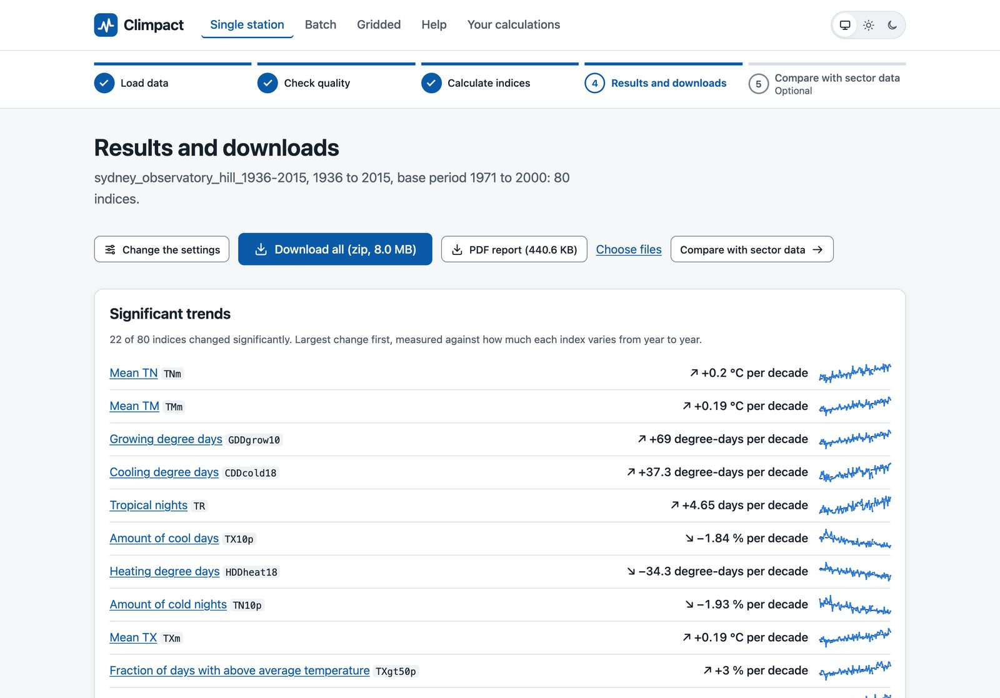
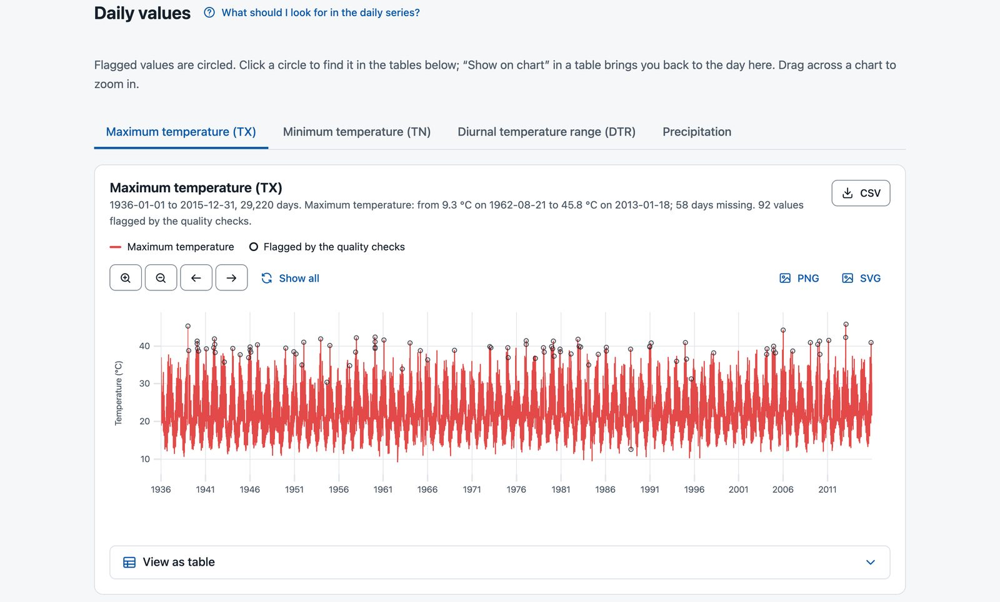
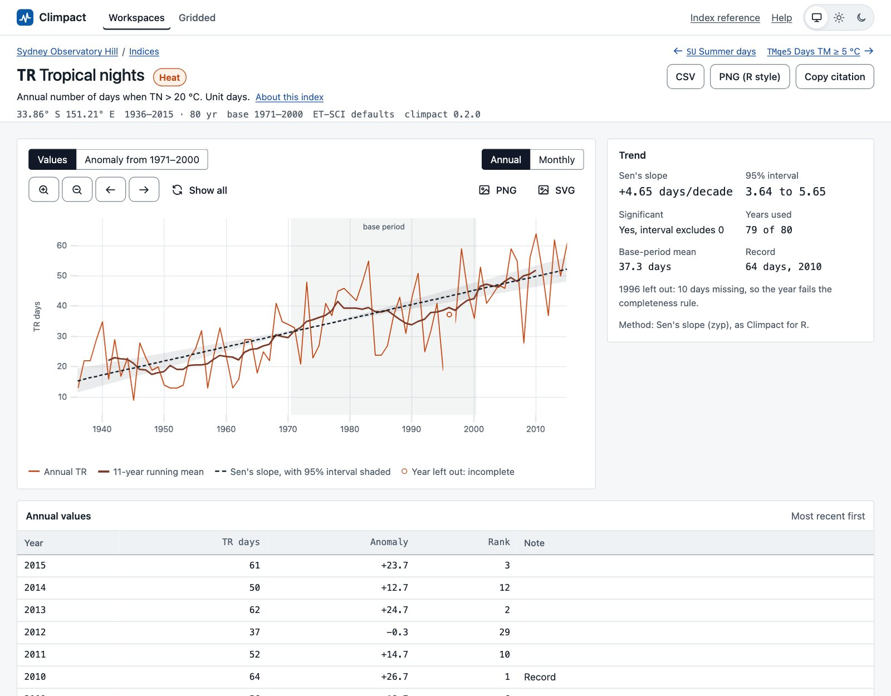
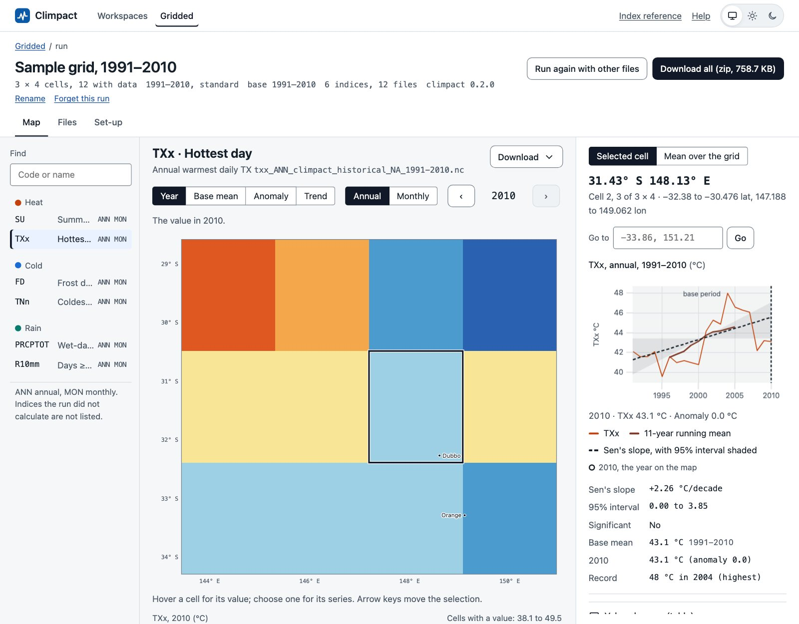
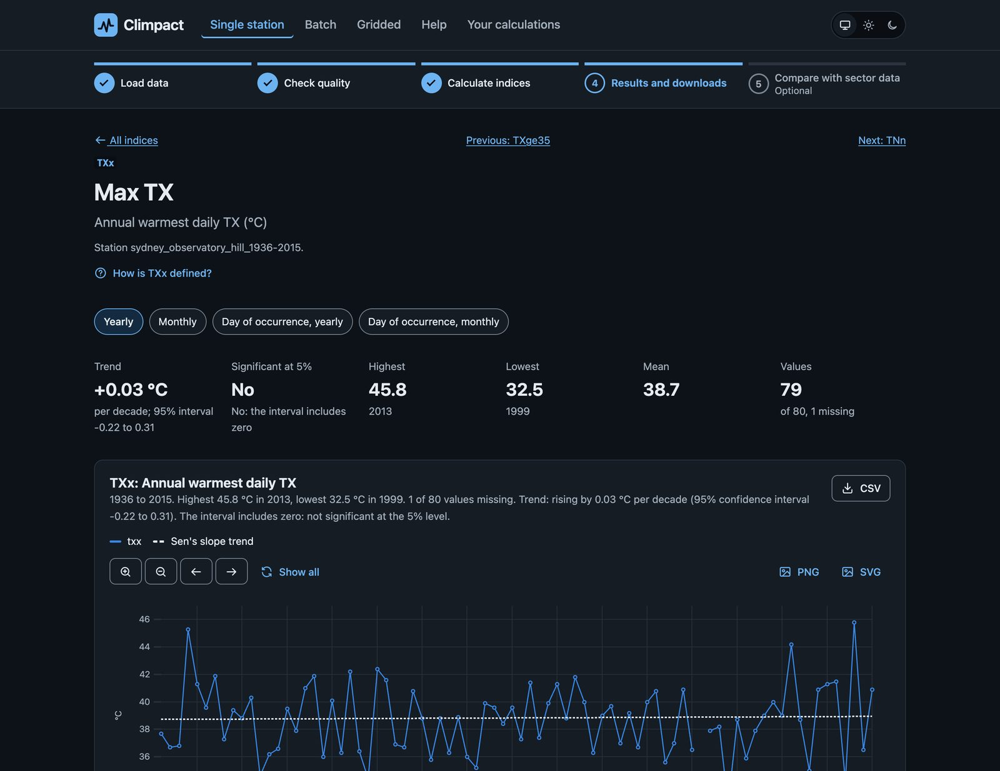

<div align="center">

# Climpact for Python

**Indices of daily climate extremes: from station records to heatwave, drought and heavy-rain indices, in your browser or from the command line.**

[](https://github.com/geoffwalmsley/climpactpy/actions/workflows/ci.yml)
[](https://pypi.org/project/climpact/)
[](https://pypi.org/project/climpact-web/)
[](https://pypi.org/project/climpact/)
[](TECHNICAL.md#parity-testing)
[](https://github.com/geoffwalmsley/climpactpy/pkgs/container/climpact-web)
[](LICENSE)

[**Try it at climpact.app**](https://climpact.app) · [Install](#installing) · [Command line](#command-line) · [Technical notes](TECHNICAL.md) · [Changelog](CHANGELOG.md)



</div>

Climpact for Python is a port of [Climpact](https://github.com/ARCCSS-extremes/climpact), the R
software national meteorological services use to calculate the climate-extremes indices
defined by the WMO Expert Team on Sector-specific Climate Indices (ET-SCI). It keeps the
science and the output files of Climpact v3.4.3, so results can be compared with existing
Climpact work, and adds a modern web app and a scriptable command line.

## Highlights

- **The same results as Climpact for R.** Every output file of 15 reference stations is
  text-identical to R's (1,791 of 1,791), and every variable of the gridded netCDF outputs is
  bit-identical (3,006 of 3,006), checked on every pull request. See
  [Parity testing](TECHNICAL.md#parity-testing).
- **All the indices.** 80 ET-SCI indices per station, including Tx90/Tn90 and EHF heatwaves,
  SPI and SPEI, with quality control, base-period thresholds, Sen's-slope trends and sector
  correlation.
- **A guided web app.** Load a file, review the quality checks on interactive charts, then
  calculate and explore every index, with help next to each field. It runs offline on your
  own computer, or hosted for a team.
- **Fast and scriptable.** An 80-year station takes about 5 seconds. Batches run one station
  per CPU core, and gridded netCDF data are processed cell by cell in bounded memory.
- **Files that drop into existing workflows.** CSV files in Climpact R's exact layout, R-style
  plots, a zip in R's folder structure, and a PDF report for each station.
- **Accessible.** Built to WCAG 2.1 AA and tested automatically on every page, with light and dark themes and layouts that
  work on a phone.

## The web app

Use the hosted app at **[climpact.app](https://climpact.app)** (single stations and batches),
or run it on your own computer with `climpact-web`, which also processes gridded data and
needs no internet connection. Each step shows its results before you move on.

<table>
  <tr>
    <td width="50%"><br><sub><b>Check quality.</b> Outliers, jumps, flat runs, impossible values and missing data, flagged on the chart and in tables. Your data is never changed.</sub></td>
    <td width="50%"><br><sub><b>Explore every index.</b> Trend per decade with its 95% interval, an interactive chart, anomalies, seasonal trends and downloads.</sub></td>
  </tr>
  <tr>
    <td width="50%"><br><sub><b>Gridded data.</b> One netCDF file per index, a map of any index and year, and the time series of any cell.</sub></td>
    <td width="50%"><br><sub><b>Light and dark themes,</b> keyboard-navigable charts with text summaries and table views.</sub></td>
  </tr>
</table>

## Installing

```sh
pip install 'climpact[plots]'   # the core and the `climpact` command (plots: matplotlib)
pip install climpact-web        # the browser app, run with `climpact-web`
```

Python 3.12 or later. To host the web app, use the container image
[`ghcr.io/geoffwalmsley/climpact-web`](https://github.com/geoffwalmsley/climpactpy/pkgs/container/climpact-web).
Both packages and the image are released together, with one version number, from GitHub
Releases (see [RELEASING.md](RELEASING.md) and [CHANGELOG.md](CHANGELOG.md)).

## Quick start

Start the web app; it opens in your browser:

```sh
climpact-web                      # options: --no-browser, --port, --host, --data-dir
```

Press **Try with sample data** to walk through a full run with Climpact's Sydney Observatory
Hill record.

## Command line

The `climpact` command calculates everything the web app does and writes the same files.

```sh
# One station: quality control, indices, thresholds and trends (125 CSV files)
climpact run station.txt --out outputs --lat -33.86 --lon 151.21

# ...with R-style plots, a zip of the results and a PDF report
climpact run station.txt --out outputs --lat -33.86 --lon 151.21 --plots --zip --report

# Every station of a Climpact R batch metadata file, one per CPU core
climpact batch metadata.txt station_files/ --out outputs

# Correlate yearly sector data (e.g. crop yields) with a station already run
climpact sector-correlation station.txt wheat_yield.csv --out outputs

# Gridded netCDF data: base-period thresholds, then every index of every cell
climpact gridded-thresholds tasmax.nc tasmin.nc pr.nc --out thresholds.nc
climpact gridded-indices tasmax.nc tasmin.nc pr.nc --out indices/ --workers 4
# A variable split by year: give its files, or a quoted pattern; they are joined along time
climpact gridded-indices 'tasmax_day_*.nc' 'tasmin_day_*.nc' 'pr_day_*.nc' --out indices/
```

Station files are the standard Climpact / RClimDex text format: one line per day with year,
month, day, precipitation (mm), maximum and minimum temperature (°C), and `-99.9` for missing
values. Defaults follow the Climpact app (base period 1971-2000); `climpact <command> --help`
lists every option.

Quality control, homogeneity and index calculation are separate modules, and other packages
can add their own as plugins: `climpact modules` lists those installed, and `--qc`,
`--homogeneity` and `--indices` select them (see
[Modules and plugins](TECHNICAL.md#modules-and-plugins)).

## Repository layout

The repository holds two Python packages, released together with one version number:

- `packages/climpact`: the core package (distribution `climpact` on PyPI, imported as
  `climpact`), with its tests and the R parity suite. It has no web dependencies:
  `pip install ./packages/climpact` installs only the core.
- `packages/climpact-web`: the web front end (distribution `climpact-web`, imported as
  `climpact_web`, Django + htmx), which depends on the core at the same version.

The repository keeps its name, `climpactpy`, which was also the core's distribution name
until #131. `reference/` holds the R reference outputs used for parity testing (see
[`reference/README.md`](reference/README.md)).

## Development

Requires Python 3.12+ and [uv](https://docs.astral.sh/uv/). The repository is a uv
workspace: `uv sync` makes one virtual environment (`.venv`) with both packages installed
in editable mode and the development tools, at the versions in `uv.lock`:

```sh
uv sync
uv run ruff check . && uv run ruff format --check .
uv run pytest                      # both packages' tests, including R parity
uv run pytest packages/climpact    # the core only
uv run pytest -m browser           # the browser accessibility checks (needs Chrome; left out above)
uv run climpact-web                # the web app from the working tree
```

Without uv, `pip install -e packages/climpact -e packages/climpact-web` and
`pip install --group packages/climpact/pyproject.toml:dev --group
packages/climpact-web/pyproject.toml:dev` (pip 25.1+) also work, but are not locked.

See [TECHNICAL.md](TECHNICAL.md) for the architecture, parity testing and every difference
between the Python and R implementations.

## Acknowledgements and licence

[Climpact](https://github.com/ARCCSS-extremes/climpact) (R) builds on the climdex.pcic and
climdex.pcic.ncdf packages of the [Pacific Climate Impacts Consortium](https://www.pacificclimate.org/).
The index definitions are on the [Climpact website](https://climpact-sci.org/indices/).
Climpact for Python is released under the
[GNU General Public License v3.0 or later](LICENSE).
